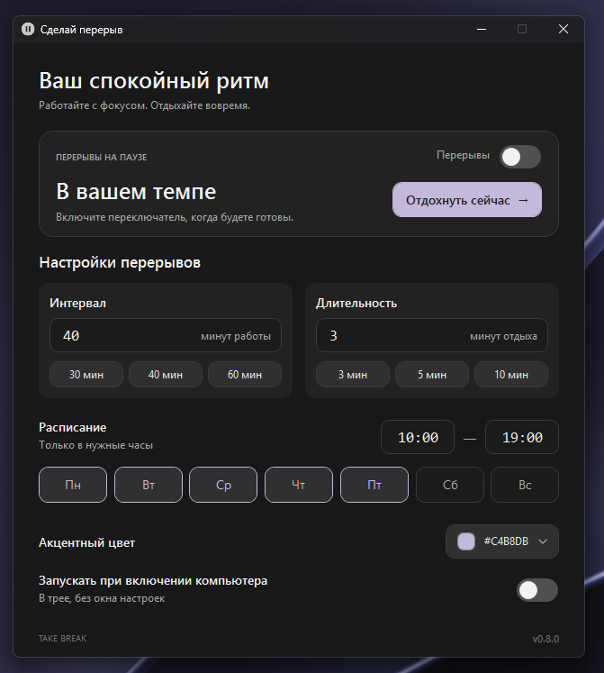
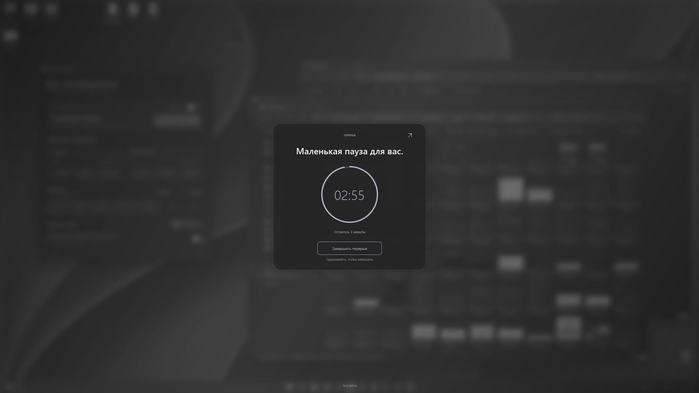

# Take Break

Приложение для регулярных перерывов: серый блюр на всех мониторах, обратный отсчёт и компактная мини-панель.

**Windows 10/11 · x64 · v0.8.0**

## Возможности

- Настраиваемые интервал, длительность, рабочие часы и дни недели.
- Мини-панель поверх окон без остановки таймера.
- Выбор акцентного цвета с живым предпросмотром.
- Работа в трее и автозапуск при входе в Windows.
- Без интернета и установки .NET для готовой сборки.

## Интерфейс

| Настройки | Экран перерыва |
| :---: | :---: |
| <a href="Assets/main.png"></a> | <a href="Assets/blur.png"></a> |

## Запуск

1. Задайте расписание и включите **Перерывы**.
2. Для ручного запуска нажмите **Отдохнуть сейчас**.

Закрытие окна оставляет приложение в трее. Двойной щелчок по значку открывает настройки, пункт **Выход** полностью закрывает приложение.

Для автозапуска включите **Запускать при включении компьютера**. После переноса `.exe` в другую папку выключите и включите этот переключатель заново.

## Управление перерывом

- Иконка справа сверху сворачивает экран перерыва в мини-панель; иконка разворачивания возвращает блюр.
- Удерживайте **Завершить перерыв** в течение **1,2 секунды** или нажмите **Esc** для немедленного завершения.
- Пробный запуск через 3 секунды доступен в меню трея.

Следующий интервал отсчитывается после завершения перерыва. Ночное расписание поддерживается; одинаковое время начала и конца означает круглосуточную работу.

Блюр использует неподвижный снимок рабочего стола в памяти. Снимки не сохраняются на диск.

## Сборка и проверка

Требуются Windows и [.NET SDK 8](https://dotnet.microsoft.com/download/dotnet/8.0).

```powershell
.\scripts\build.ps1
```

Скрипт запускает тесты и создаёт автономный `dist/TakeBreak.exe`. Перед пересборкой завершите работающую версию через трей.

```powershell
dotnet run --project tests/TakeBreak.Tests.csproj
dotnet run --project TakeBreak.csproj
.\dist\TakeBreak.exe --smoke-test
```

`--smoke-test` проверяет интерфейс и завершается автоматически. Код выхода `0` — успешно.

Настройки и журнал ошибок: `%LocalAppData%\TakeBreak\settings.json` и `errors.log` в той же папке.
